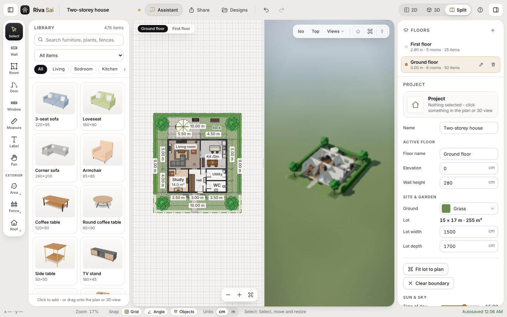

# Riva Sai plugin for Claude

Design homes, interiors and gardens with Claude in [Riva Sai](https://rivasai.com), the free 2D/3D
home planner in the browser. Claude asks about your space, lays out the rooms, doors, windows and
furniture, checks the plan, and gives you a link that opens the design at rivasai.com in 2D and 3D.



The plugin is in [`plugins/riva-sai`](plugins/riva-sai/README.md): a skill, two commands and a local,
read-only MCP server in plain Node.js. It has no dependencies, needs no network access and collects
no data ([privacy](plugins/riva-sai/PRIVACY.md)).

## Install

In Claude Code:

```bash
claude plugin marketplace add samsam32118/rivasai-plugin
```

```bash
claude plugin install riva-sai@rivasai
```

Requires Node.js 18 or later. To update later: `claude plugin update riva-sai@rivasai`.

## This repository

| Path | What it is |
|---|---|
| `.claude-plugin/marketplace.json` | Makes this repository a plugin marketplace named `rivasai` |
| `plugins/riva-sai/` | The plugin |
| `tests/` | Packaging, plan-checker and MCP protocol tests (`npm test`, no dependencies) |
| `.github/workflows/check.yml` | Runs the tests and `claude plugin validate --strict` on every push |

The catalog, API method list and guides in `plugins/riva-sai/server/data/` and
`plugins/riva-sai/skills/riva-sai-home-design/references/` are generated from the Riva Sai app
source. Do not edit them by hand. Everything else is hand-written.

### Releasing

1. Update the generated data from the app repository if the catalog or API changed.
2. Bump `version` in `plugins/riva-sai/.claude-plugin/plugin.json` (installed copies update only
   when it changes) and note the change in [CHANGELOG.md](CHANGELOG.md).
3. Run `npm test` and `claude plugin validate --strict ./plugins/riva-sai`, then push to `main`.

## License

[MIT](LICENSE)
