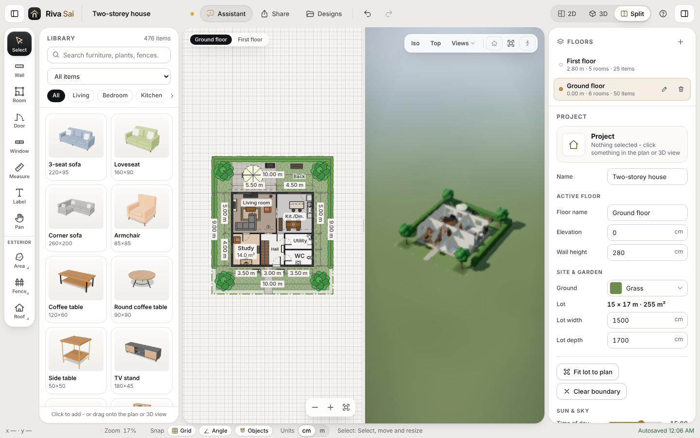

# Riva Sai plugin for Claude

Design homes, interiors and gardens with Claude in [Riva Sai](https://rivasai.com), the free 2D/3D
home planner in the browser. Describe your space, or share a sketch, photo or floor plan. Claude
asks a few questions, lays out the rooms, doors, windows and furniture, and checks the plan. It then
gives you a link that opens the design at rivasai.com in 2D and 3D, ready to walk through and change.



## What you get

- **Skill `riva-sai-home-design`.** Claude's workflow for planning a home with you: it asks one or two
  questions at a time, assumes typical sizes instead of demanding measurements, follows the layout
  rules (walkways, clearances, which way furniture faces), and keeps building on your latest version
  when you change things in the app.
- **Commands.**
  - `/riva-sai:design-home [brief]` starts a design.
  - `/riva-sai:check-plan [script or link]` checks and repairs a plan script.
- **MCP server `riva-sai`.** Local, plain Node.js, with no dependencies and no network access. Every
  tool is read-only:

  | Tool | What it does |
  |---|---|
  | `riva_guide` | The design guide: conventions, plan-script format, methods, catalog |
  | `riva_search_catalog` | Searches 470+ furniture, fixture, door, window, plant and exterior items, with real sizes |
  | `riva_list_options` | Categories, floor and wall materials, furniture finishes, starter templates |
  | `riva_check_plan` | Checks a plan script: format, calls and options, catalog ids, materials, facing, references, and layout (overlaps, furniture through walls, doors off walls or in corners). Returns the link when the script is valid |
  | `riva_plan_link` | Makes the rivasai.com link for a valid plan script |
  | `riva_read_design` | Reads a Riva Sai share link (`#p=` / `#plan=`) or project JSON you bring back |

## Install

In Claude Code:

```bash
claude plugin marketplace add samsam32118/rivasai-plugin
```

```bash
claude plugin install riva-sai@rivasai
```

Or inside a session: `/plugin marketplace add samsam32118/rivasai-plugin`, then
`/plugin install riva-sai@rivasai`. Requires Node.js 18 or later (the MCP server runs with `node`).

## Try it

> Plan a 65 m² two-bedroom flat for a couple with a baby: open kitchen and living room, a bathroom
> with a bathtub, and a small home office corner.

> Here's a photo of my living room, about 4 by 5 metres. Where should the sofa and TV go?

> /riva-sai:design-home a small garden house with a deck, a pool and a vegetable bed

Claude answers with a link like `https://rivasai.com/#plan=...`. Open it to see the design in 2D and
3D. Change anything in the app, then use **Assistant > Copy design** and paste the result back to
Claude to keep working on the same design.

## Privacy

The plugin collects nothing. The MCP server sends nothing over the network and writes no files.
Designs travel inside the link, after the `#`, which browsers never send to the server. See
[PRIVACY.md](PRIVACY.md).

## For developers

Source: [github.com/samsam32118/rivasai-plugin](https://github.com/samsam32118/rivasai-plugin).

- `server/riva-sai-mcp.mjs` is hand-written, readable JavaScript.
- `server/data/*.json` and `skills/riva-sai-home-design/references/*.md` are generated from the
  Riva Sai app source (`npm run claude-plugin -- --out <this repository>` in the app repository).
  The app's tests fail when they are out of date and check that this plugin's plan checker agrees
  with the real Riva Sai engine.
- `npm test` at the repository root runs this repository's own tests (Node's built-in test runner,
  no dependencies).

Support: [GitHub issues](https://github.com/samsam32118/rivasai-plugin/issues).

## License

The plugin (this folder) is under the [MIT License](LICENSE).
